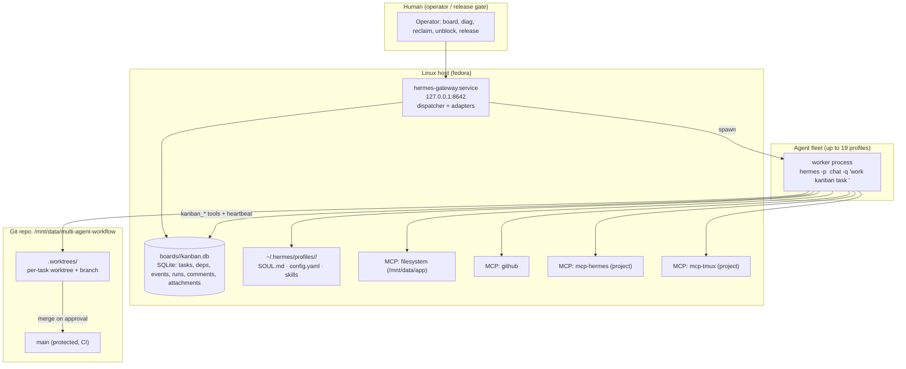
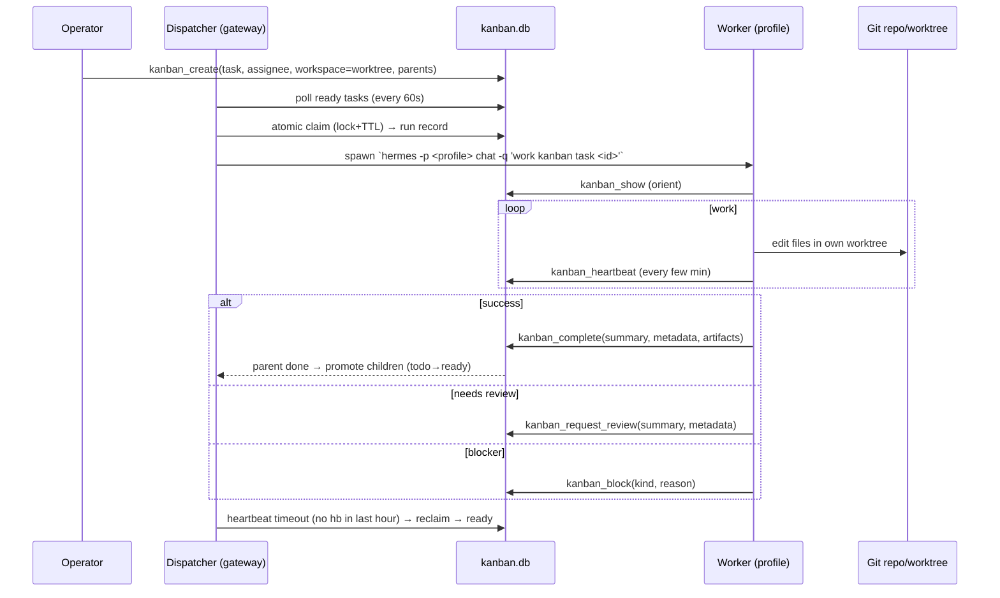
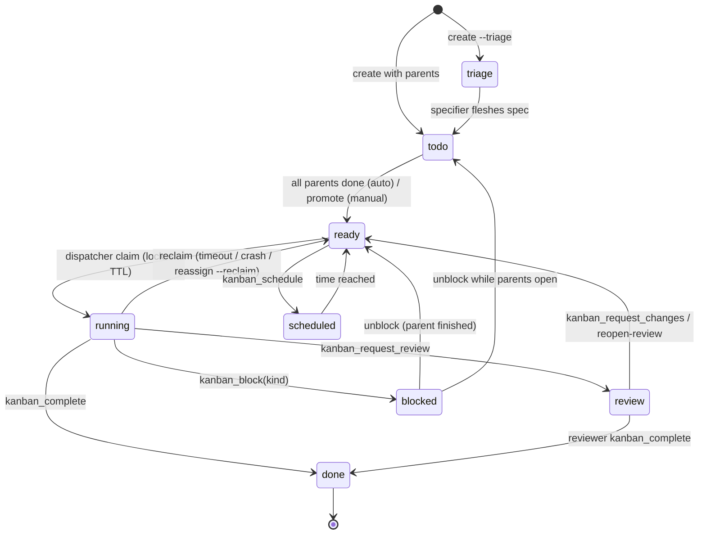
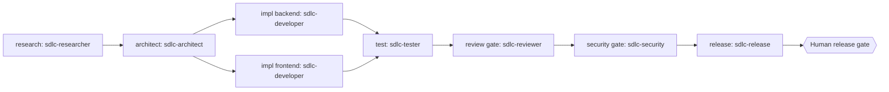
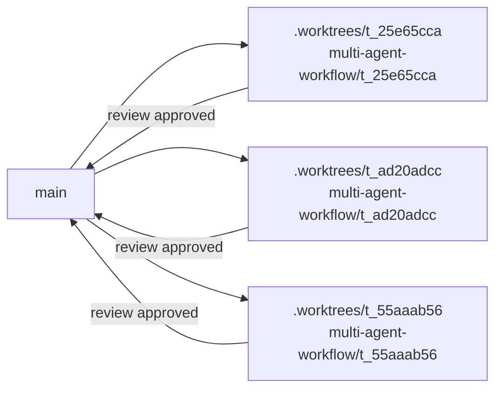
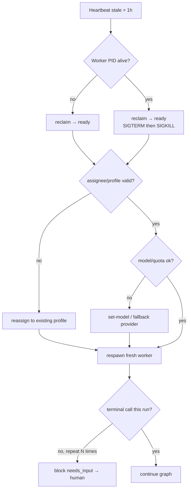

# ADR-010: Multi-Agent Autonomous Development System for Multi-Agent Workflow Platform

- **Status:** Proposed (architect) — pending independent review (`sdlc-reviewer`) and security gate (`sdlc-security`).
- **Date:** 2026-10-09
- **Author:** `sdlc-architect` (task `t_c55dd026`)
- **Deciders:** project owner (human release gate), `sdlc-architect`, `sdlc-security`, `sdlc-release`
- **Supersedes:** the ad-hoc "tmux sessions + shared worktree" operating mode currently in use.
- **Related:** `docs/architecture.md`, `docs/decisions.md`, ADR-004 (auth/session), ADR-005 (secrets/TLS), ADR-009 (OCI payload), `docs/offline-bundle-v1.md`, `CONTRIBUTING.md`.

> Scope note: this ADR specifies the **development/coordination system** (how 19 agent profiles build the portal), not the portal product architecture itself. Product architecture remains owned by `docs/architecture.md` and the existing ADRs. Where this system produces project-facing docs, the project's Russian-language documentation rule (`CONTRIBUTING.md`) applies; this ADR is written in English because it is consumed by the agent tooling workstreams (`t_25e65cca` implement, `t_55aaab56` docs, `t_ad20adcc` test).

---

## 1. Context and problem

Multi-Agent Workflow Platform is a multi-agent software-development platform with a mature engineering baseline: git repo at `/mnt/data/multi-agent-workflow`, `main` protected by CI (`.github/workflows/ci.yml`), Conventional Commits, an ADR registry, `make` gates, and >70% backend coverage expectations. The current multi-agent setup runs agents as long-lived **tmux sessions sharing one worktree**, which produces exactly the failure classes the research report (`t_ca94c155`) calls out: two agents editing the same file, branch conflicts, and no authoritative "who owns what".

The Hermes Kanban system is already installed and running in this environment (see §2 verified facts): a durable SQLite board, a gateway-hosted dispatcher, atomic task claiming, dependency DAGs, per-task git worktrees, review lifecycle, and structured handoffs. We already run 9 SDLC gate profiles and the board `me` is actively coordinating real tasks — including this one, whose **prior run crashed with a protocol violation** (worker exited `rc=0` without a terminal kanban call) and a later run **blocked on a stale model override**. Those are real, observed failure modes this architecture must eliminate by construction.

### 1.1 Requirements (from task `t_c55dd026`)

| # | Requirement |
|---|-------------|
| R1 | Support 19 specialist profiles running in parallel |
| R2 | Use the Hermes Kanban board as the coordination backbone |
| R3 | Git worktree isolation per agent (replace shared worktree + tmux) |
| R4 | MCP servers: `filesystem` + `github` (already configured) |
| R5 | Gateway as a systemd service on `127.0.0.1:8642` |
| R6 | Respect project context: Ed25519 signing, Offline Bundle Protocol v1, Skopeo + Helm OCI transfer |

### 1.2 Goals / non-goals

**Goals:** deterministic lifecycle; no two writers on one file; every handoff durably recorded; stalled/never-started work detected and recovered; no secret in board metadata; the human release gate preserved.

**Non-goals:** replacing Hermes Kanban with a new orchestrator; introducing Redis/Celery/Temporal (the board's SQLite is the durable store); horizontal multi-host scaling (single-host, single gateway is the v1 boundary, mirroring the product's own single-instance OperationManager boundary); rewriting the 9 existing SDLC profiles.

---

## 2. Verified environment facts (grounding)

These were inspected during this task (not taken on faith from the research report):

- **Gateway:** user unit `hermes-gateway.service` (`~/.config/systemd/user/hermes-gateway.service`), `Active: running`, `ExecStart=… hermes gateway run`, `Restart=always`, listening on **`127.0.0.1:8642`** (confirmed via `ss -ltnp`). Dispatcher runs **inside the gateway** (`kanban.dispatch_in_gateway: true`); `hermes kanban daemon` is deprecated.
- **Kanban config** (`~/.hermes/config.yaml`, `kanban:` block): `dispatch_in_gateway: true`, `dispatch_interval_seconds: 60`, `failure_limit: 2`, `orchestrator_profile: ''`, `default_assignee: ''`, `auto_decompose: true`, `auto_decompose_per_tick: 3`, `dispatch_stale_timeout_seconds: 14400` (4 h).
- **Kanban CLI surface** (`hermes kanban --help`): `init, boards, create, swarm, list, show, assign, set-model, reclaim, reassign, diagnostics(diag), link, unlink, claim, comment, attach, attachments, attach-rm, complete, edit, block, schedule, unblock, request-review, request-changes, reopen-review, promote, archive, tail, dispatch, watch, stats, notify-subscribe, notify-list, notify-unsubscribe, log, runs, heartbeat, assignees, context, specify, decompose, gc, repair`.
- **Task-creation flags** (`kanban create --help`): `--workspace scratch|worktree|worktree:<path>|dir:<path>`, `--branch`, `--project`, `--tenant`, `--priority`, `--triage`, `--idempotency-key`, `--max-runtime` (`300`/`90s`/`30m`/`2h`/`1d`), `--created-by`, `--skill`, `--max-retries N`, `--model`, `--provider`, `--completion-contract`, `--goal`, `--goal-max-turns`, `--initial-status`, `--json`.
- **Project-linked worktrees:** `hermes project …` binds a board to a project; project tasks get a deterministic worktree at **`<repo>/.worktrees/<task-id>`** with branch `<project-slug>/<task-id>` (confirmed in `hermes_cli/kanban_db_graph.py`). `hermes project list` currently reports **no projects created**, so the `multi-agent-workflow` board is **not yet anchored to a repo**. `hermes kanban create --workspace` also accepts an explicit `worktree:<path>` or `dir:<path>`.
- **MCP servers running** under the gateway: `mcp-server-filesystem` (root `/mnt/data/app`), `mcp-server-github`, and two project-local servers `mcp-hermes` and `mcp-tmux` (from `/mnt/data/multi-agent-workflow/{mcp-hermes,mcp-tmux}`).
- **Profiles present** (`~/.hermes/profiles/`): `sdlc-{planner,researcher,architect,developer,tester,reviewer,security,release,fixer}` (**9 SDLC gate roles**), plus `hermes-dev`, `processauto-check`, `processauto-pulse`; the default profile is named `default`. A `doc-writer` assignee is referenced by card `t_55aaab56` but **no `doc-writer` profile directory exists** — an instance of the "unknown assignee" failure (§9).
- **Per-profile config** (`<profile>/config.yaml`): `model.default` + `model.provider`, `agent.max_turns` (architect: 40; developer: 90; fixer: 60; release: 30), and a `toolsets` block (`web, file, terminal, skills, todo, kanban, memory, code_execution`). Role descriptions live in `<profile>/profile.yaml`.
- **Observed failure modes on this board:** run 4 = `protocol_violation` (clean exit without terminal kanban call); run 8 = `blocked` with reason "Force model switch … current run uses stale nvidia model"; recovery = `set-model` to `deepseek/deepseek-v4.1-flash`.

---

## 3. System context



**Data flow (single task):**



---

## 4. Decision: Kanban-as-backbone, single durable store

**Problem.** Agents need a coordination substrate that survives process restarts, records who did what, and gates flow without a human in the loop for routine work.

**Decision.** Use the Hermes Kanban board (`kanban.db`, SQLite, WAL) as the **single durable source of truth** for task state, dependencies, runs, events, comments and artifacts. Do **not** add an external state store. The gateway-hosted dispatcher is the only scheduler. One board per project, `multi-agent-workflow`, bound to the project repo via `hermes project create multi-agent-workflow --…` + `hermes project bind-board`.

**Rationale.** It is already installed, already running the dispatcher in the gateway, and already models every primitive we need (atomic claim, DAG, review, block kinds, reclaim, diagnostics, artifacts). Introducing Redis/Postgres/Temporal would duplicate durable state and add an operational dependency the single-host v1 does not need.

**Consequences.** The board's SQLite file is a critical asset: it must be backed up (`hermes kanban gc`, `boards/<slug>/kanban.db` snapshot) and never edited by hand. Throughput is bounded by `dispatch_interval_seconds` (60 s) and by single-host process limits; scale-out is out of scope.

**Rejected alternatives.** See §12.

---

## 5. Agent lifecycle

Canonical states: `triage → todo → ready → running → (review | done | blocked | scheduled)`.



### 5.1 Lifecycle contract (normative)

1. **Spawn.** Dispatcher claims a `ready` task atomically (records `run_id`, lock with TTL) and spawns `hermes -p <profile> chat -q "work kanban task <task-id>"` with the resolved workspace path. The worker is a *fresh process per run* — no long-lived tmux session.
2. **Claim.** Only the dispatcher claims. A worker never self-claims; it works the task id it was handed.
3. **Orient.** The worker calls `kanban_show()` first; the injected `worker_context` (title, body, parent handoffs, prior attempts, comments) is treated as ground truth.
4. **Work.** All writes happen **inside the worker's own worktree**. No writes to another task's worktree or to the shared checkout.
5. **Heartbeat.** For runs longer than a few minutes, the worker calls `kanban_heartbeat` at least once per hour (mandatory for any run that may exceed 1 h). Missing heartbeats for > 1 h make the task reclaimable.
6. **Terminal call (mandatory).** Every run MUST end in exactly one of `kanban_complete`, `kanban_request_review`, or `kanban_block`. **A clean process exit without a terminal call is a protocol violation** (observed on this task) and is treated as a failed run: the dispatcher re-queues it.
7. **Reclaim.** On stale heartbeat, crash (PID gone), or `--max-runtime` expiry, the dispatcher SIGTERMs/SIGKILLs the worker and returns the task to `ready` with an incremented/recovered run record. Reclaim is **not** a failure counter tick when caused by timeout/staleness (no penalty).
8. **Complete.** `kanban_complete` records `summary` + structured `metadata` + `artifacts` (absolute paths); it is the event that **promotes children** from `todo` to `ready`.

### 5.2 Terminal-call selection rule (review model)

- If the task has **pre-created review/QA/release children** → call `kanban_complete` (completion releases those children). Never `kanban_request_review` on the same card *and* leave review children — that strands or duplicates the lane.
- Else, if the card needs same-card review → `kanban_request_review`.
- Only genuine external blockers use `kanban_block`; review is never a block (it must not trip the unblock-loop detector).

---

## 6. Task graph patterns

| Pattern | Construction | Use for |
|---|---|---|
| **Pipeline (sequential)** | child `parents=[prev]` | schema → API → tests → docs; phase-gated SDLC |
| **Fan-out / fan-in** | N parallel workers, each `parents=[root]`; 1 synthesizer `parents=[all workers]` | research across dimensions; per-component implementation |
| **Swarm v1** | `hermes kanban swarm <goal> --worker p:t[:skills] … --verifier V --synthesizer S` | standard "parallel workers → verify → synthesize" |
| **Role pipeline + review gate** | implementer → `request-review` → reviewer → `complete` or `request-changes` (bounded) | quality-critical code, security-sensitive changes |
| **Parallel lanes** | independent sub-graphs under a phase root | backend / frontend / infra / docs tracks |
| **Triage-then-decompose** | `--triage` + `auto_decompose: true` | large ambiguous goals |

**Decomposition rules.** Each card is assignable to exactly ONE profile; has verifiable acceptance criteria; is sized < 2 h; dependencies are explicit parent links (never prose); the graph is a **DAG** (cycles rejected by `kanban_link`).

**Bounded review loop.** `request-changes` cycles are capped (recommend 3). Non-convergence = identical feedback repeated → escalate to a human via `kanban_block(kind="needs_input")`, never an infinite loop. This mirrors the research report's `BoundedRetry`.

**Example feature pipeline** (Multi-Agent Workflow Platform feature "destination mapping for mixed bundles"):



---

## 7. Workspace isolation

**Decision.** Default all code-mutating tasks to **per-task git worktree** isolation. Use `scratch`/`dir` only for non-repo work.

| `--workspace` | Location | Writer model | When to use |
|---|---|---|---|
| `worktree` (project-linked) | `<repo>/.worktrees/<task-id>`, branch `<project-slug>/<task-id>` | fully isolated, merge on approval | **default for any task that edits the repo** (implement/test/fix/docs) |
| `worktree:<path>` / `--branch` | explicit path + branch | isolated | when a card must reuse a named branch (e.g. long-lived epic) |
| `scratch` | board temp dir, auto-cleaned | one writer | pure analysis/draft deliverables (research reports, ADRs, plans) |
| `dir:<path>` | shared absolute dir | shared | read-only aggregation, dashboards, cross-task synthesis where no code is written |

**Branch naming.** Deterministic from the project binding: `<project-slug>/<task-id>` (e.g. `multi-agent-workflow/t_25e65cca`). Human-authored feature branches keep `CONTRIBUTING.md` conventions (`feat/<scope>`, `fix/<scope>`, `docs/<scope>`, `chore/<scope>`); agent task branches are namespaced so they never collide with human branches.

**Merge policy.** No agent commits to `main`. On an approved review/release gate, the task's worktree is squash-merged (no-ff) into `main` with a Conventional Commit message; a merge conflict **blocks the task and preserves the worktree**. `main` stays protected by CI.

**Cleanup.** `hermes kanban gc` prunes finished worktrees; a worktree is preserved whenever its task is `blocked` or `review`.



*Note: target location is `<repo>/.worktrees/` (Hermes project convention). The currently observed `.kilo/worktrees/` directory belongs to the Kilo editor and is outside this system's ownership.*

---

## 8. Conflict prevention

Three layers of defense:

**Layer 1 — isolation (structural).** Per-task worktrees (§7) make write-write collisions impossible at the filesystem level; git resolves at merge.

**Layer 2 — file ownership registry (declarative).** Each implementation card body declares an **owned-files / forbidden-files work packet**, and `kanban_complete.metadata` echoes `changed_files`:

```json
{
  "owned_files":    ["backend/app/transfer/**", "backend/tests/transfer/**"],
  "forbidden_files":["backend/app/auth/**", "apps/frontend/**"],
  "changed_files":  ["backend/app/transfer/destination_mapping.py"]
}
```

The orchestrator (planner profile) allocates non-overlapping ownership when fanning out. Two sibling cards that would own the same glob are a decomposition error and must be re-split before dispatch.

**Layer 3 — hotspot detection (dynamic).** A `scripts/detect-hotspots.py` CLI (implemented by `t_25e65cca`) reads recent completions' `metadata.hotspot`/`changed_files`, cross-references `git diff --name-only` across active worktrees, and emits a collision report. When a file the worker's diff touches also appears in sibling cards' recent comments, the worker leaves a comment `hotspot: <path> — <reason>` and repeats the flag in completion metadata so the orchestrator can decompose that file before more work lands on it.

**Conflict scenarios and responses** (research §3.2 formalized):

| Scenario | Detection | Response |
|---|---|---|
| Write-write (same file, two cards) | hotspot report / owned-glob overlap | re-split into distinct owners; serialize via parent link |
| Read-write (stale read) | base SHA drift vs worktree HEAD | rebase worktree on `main` before merge; if semantic conflict → reconcile card |
| Semantic (contradictory outputs) | reviewer/verifier disagreement | route to `sdlc-architect` for a binding decision (ADR if cross-cutting) |
| Merge conflict at gate | `git merge` fails | `kanban_block(kind="capability")`, preserve worktree, list conflicted files |

---

## 9. Context passing (structured handoffs)

Every terminal transition carries a **structured handoff**. Secrets, tokens and raw PII are never placed in `summary`, `metadata`, comments or artifacts.

**Handoff envelope** (canonical fields; all handoffs carry at least `summary` + `metadata`):

```json
{
  "summary": "1–3 sentence human-readable outcome",
  "metadata": {
    "changed_files": ["backend/app/transfer/destination_mapping.py"],
    "decisions": ["reuse existing digest-conflict policy; no new overwrite path"],
    "tests_run": 14,
    "test_results": "all_passed",
    "constraints_discovered": ["legacy bcrypt config incompatible with new loader"],
    "hotspot": ["backend/app/transfer/__init__.py"],
    "trace_id": "<propagated from the feature root card>",
    "idempotency_key": "sha256(trace_id + step)",
    "verification": "command actually run + observed result"
  },
  "artifacts": ["/abs/path/report.md", "/abs/path/coverage.png"]
}
```

**Rules.**

1. **Summary is for humans; metadata is for machines.** Downstream workers read parent handoffs from `worker_context`; they must **re-verify** point-in-time facts before acting on them.
2. **Artifacts are real paths** that exist at completion; uploads are capped at 25 MB. Workers attach to their **own** task only.
3. **Changed files are declared** so hotspot detection and merge review have ground truth.
4. **Child summaries are self-reports, not verified facts.** A child claiming "uploaded/merged successfully" must carry a verifiable handle (commit SHA, PR URL, absolute path) that the parent verifies.
5. **Trace/idempotency.** A feature root card mints `trace_id`; it propagates through metadata so retried handoffs can be deduplicated (`--idempotency-key` on creation).

---

## 10. Observability

Built on the board's own events/runs and CLI, plus the unnotifiable gaps we must close.

| Signal | Source | Threshold / action |
|---|---|---|
| **Task status counts & oldest-ready age** | `hermes kanban stats` | oldest-ready age growing → investigate dispatcher/assignee |
| **Structured diagnostics** | `hermes kanban diagnostics [--severity error] [--json]` | any `error`/`critical` → triage |
| **Live event stream** | `hermes kanban watch` / `kanban tail <id>` | monitor `completed`, `blocked`, `gave_up`, `timed_out`, `protocol_violation`, `reclaimed` |
| **Run history** | `hermes kanban runs <id>` | inspect outcome per attempt; detect repeated `crashed` |
| **Heartbeat freshness (artifact age proxy)** | `task_events` heartbeat timestamps | no heartbeat > 1 h → reclaim; warning at 30 min |
| **Protocol violations** | event kind `protocol_violation` | clean-exit-without-terminal-call → auto-requeue; count per profile |
| **Stalled chain** | parent still `running`/`blocked` while children pile in `todo` | surface as dependency diagnostic; reclaim the parent or reassign |
| **Unknown assignee** | task sits in `ready` and is never claimed by any run | profile name not in `~/.hermes/profiles/` → alert + reassign (see risk SEC/RISK-1) |
| **Rate-limit / quota exhaustion** | worker/API error text; repeated requeue without failure | requeue-without-failure, switch model via `set-model`, escalate if persists |

**Rate-limit detection.** The dispatcher already requeues on transient spawn failure without incrementing the failure counter. Add an operator runbook step (§11.4) that recognizes provider quota errors and applies a `set-model`/`--fallback-provider` switch. Do **not** fabricate SLO numbers; the concrete thresholds above are the ones the environment supports.

**Alerting.** `hermes kanban notify-subscribe <task> --platform <platform> --chat-id <id>` for terminal events; the operator dashboard is `hermes dashboard` (booted with the gateway). Fleet-level health = a periodic `kanban diag --severity error --json` + `kanban stats` sweep.

---

## 11. Recovery procedures

### 11.1 Reclaim (stuck / hung run)
`hermes kanban reclaim <task-id> --reason "..."` releases the active claim → task returns to `ready`. Use on: heartbeat stale > 1 h, PID gone, or a run that closed without a terminal call. Worktree is preserved.

### 11.2 Reassign (wrong profile / capability gap)
`hermes kanban reassign <task-id> <profile> --reclaim --reason "..."`. The `--reclaim` flag is required for a running task. Use when the assigned profile cannot do the work or the assignee is unknown.

### 11.3 Model change (stale/overridden model, quota)
`hermes kanban set-model <task-id> --model <model> --provider <provider>` (takes effect **next dispatch**). This is the exact fix applied to this task after run 8 blocked on a stale nvidia override. Clear with `set-model --clear`.

### 11.4 Profile config edits
Profile behavior is edited in `~/.hermes/profiles/<name>/config.yaml` (`model.default`, `model.provider`, `agent.max_turns`, `toolsets`) and `profile.yaml` (description). Changes take effect on the **next spawn**. Remedy for: too-low `max_turns` truncating work, missing toolset (e.g. `code_execution` off for architect), wrong model.

### 11.5 Dependency unblock
- `kanban unblock <id>` → `ready` if parents done, else `todo`.
- `kanban promote <id>` → force `ready` (recovery only).
- `kanban_block(kind="dependency")` parks a card in `todo` and auto-resumes when the parent finishes — no human needed.

### 11.6 Failure-mode playbook

| Scenario | Detection | Recovery |
|---|---|---|
| Worker OOM/crash | PID check fails / run outcome `crashed` | auto-requeue → fresh worker; if repeat, reduce `max_turns` or split card |
| Protocol violation (no terminal call) | `protocol_violation` event | auto-requeue as `ready`; if repeat, fix card body clarity / SOUL |
| Missing credentials | spawn `RuntimeError` | circuit breaker after `failure_limit` (2) → `blocked` → human adds creds → `unblock` |
| Merge conflict | `git merge` fails at gate | `block(kind="capability")`, preserve worktree, list conflicted files |
| Stalled chain | children stuck in `todo` with parent not done | reclaim/reassign parent; verify parent's terminal call |
| Unknown assignee | task never claimed | reassign to an existing profile |
| Infinite review loop | repeated `request-changes` ≥ 3, identical feedback | `block(kind="needs_input")` with full feedback history |
| Rate limit | provider quota error | requeue-without-failure; `set-model`/fallback provider; escalate if persistent |



---

## 12. Decisions and rejected alternatives

### Decisions (summary)

| ID | Problem | Selected | Rationale |
|---|---|---|---|
| **AD-1** | Coordination substrate | Hermes Kanban (`kanban.db`) as single durable store | already running; atomic claim + DAG + review + artifacts; no new infra |
| **AD-2** | Isolation model | per-task git worktree (project-linked, `<repo>/.worktrees/<id>`) | eliminates write-write at FS level; deterministic branch |
| **AD-3** | Scheduling | gateway-hosted dispatcher only; no tmux worker sessions | one scheduler, PID-tracked runs, reclaim semantics |
| **AD-4** | Terminal-call rule | exactly one of complete/request_review/block; pre-created children ⇒ complete | fixes observed protocol violation; avoids stranded lanes |
| **AD-5** | Handoff contract | `summary` + structured `metadata` + `artifacts`; secrets excluded | machine-readable provenance; hotspot/merge ground truth |
| **AD-6** | Conflict prevention | 3 layers: isolation + owned-file registry + hotspot detector | declarative + dynamic coverage |
| **AD-7** | Review model | separate review child cards for multi-profile gates; same-card review otherwise; bounded (3) cycles | independent verification, no infinite loop |
| **AD-8** | Polylithic projects | bind board to a `hermes project` anchored at the repo | deterministic worktrees/branches; today unbound |
| **AD-9** | Observability | board events/runs + `diag`/`stats`/`watch` + heartbeat freshness | no external metrics stack in v1 |

### Rejected alternatives

| Decision | Option | Rejection reason |
|---|---|---|
| AD-1 | Redis/Postgres blackboard + custom orchestrator | duplicates durable state already in SQLite; adds ops burden for no v1 need |
| AD-1 | Temporal/LangGraph workflow engine | heavyweight; the board already models the DAG and retries |
| AD-2 | Shared worktree + file locks (current) | observed collisions; locks are advisory and leak on agent crash |
| AD-2 | One long-lived branch per agent persona | merge complexity grows without per-task traceability |
| AD-3 | Keep tmux sessions as the execution model | no PID/liveness contract, no reclaim, no run records |
| AD-4 | Allow clean exit to mean success | this is precisely the `protocol_violation` we observed; can't distinguish "done" from "gave up silently" |
| AD-6 | Trust agents to coordinate verbally | not enforceable; hotspot detector gives evidence |
| AD-7 | Single-round review only | insufficient for security-sensitive transfers (Ed25519/signing, air-gap integrity) |
| AD-9 | Prometheus/Grafana | no metrics endpoint in v1; the board's events are sufficient and free |

---

## 13. Implementation plan and readiness

### 13.1 Implementation sequence

1. **Project binding** — `hermes project create multi-agent-workflow` + anchor `/mnt/data/multi-agent-workflow` as primary + `bind-board`. *Blocks all worktree isolation.*
2. **Profile completion** — define the 19-profile catalog (§14); create the missing `doc-writer` and domain profiles; verify every assignee used on the board resolves to a profile.
3. **Orchestration tooling** — `scripts/spawn-agent.sh`, `agent_orchestration/agent_workspace.py`, `agent_orchestration/kanban_tools.py`, `scripts/detect-hotspots.py` (child `t_25e65cca`).
4. **Test suite** — unit/integration/chaos/e2e (child `t_ad20adcc`).
5. **Docs & runbook** — operator/dev guides + quickref (child `t_55aaab56`).
6. **Pilot** — run one real Multi-Agent Workflow Platform feature (destination mapping for mixed bundles) through the full pipeline; measure protocol-violation and collision rates.
7. **Security review** — `sdlc-security` validates §15 before the human release gate.

### 13.2 Architectural acceptance criteria (verifiable)

- [ ] `hermes project list` shows `multi-agent-workflow` bound to the repo; a created task lands in `<repo>/.worktrees/<task-id>` on branch `multi-agent-workflow/<task-id>`.
- [ ] Two sibling tasks editing the same repo complete without a write-write collision; hotspot detector reports zero un-flagged overlaps.
- [ ] A task killed mid-run (`kill -9`) is reclaimed to `ready` and completes on respawn without a failure-counter trip.
- [ ] No run on the board ends without exactly one terminal call; `protocol_violation` event count = 0 over a pilot window.
- [ ] Every task assigned to a name present in `~/.hermes/profiles/`; zero cards stuck in `ready` with an unknown assignee.
- [ ] A stale model override is cleared via `set-model` and the task proceeds on next dispatch (reproduces + resolves run-8 failure).
- [ ] Review gate: implementer → reviewer → `request-changes` (≤3) → approve; a 4th identical cycle escalates to human.
- [ ] `hermes kanban diag --severity error --json` returns clean during a healthy pilot; `hermes kanban stats` oldest-ready age stays bounded.
- [ ] No secret/token/PII present in any `summary`, `metadata`, comment or artifact (spot-check by security gate).

---

## 14. Proposed 19-profile catalog

Existing verified SDLC gate roles (9) + proposed domain specialists (10). "Exists" = profile directory present today.

| # | Profile | Exists | Role | Typical model class |
|---|---|---|---|---|
| 1 | `sdlc-planner` | ✅ | decomposes goal → executable, verifiable plan | reasoning |
| 2 | `sdlc-researcher` | ✅ | research, read-only | reasoning |
| 3 | `sdlc-architect` | ✅ | ADRs, contracts; no production code | reasoning |
| 4 | `sdlc-developer` | ✅ | implements in own worktree | code |
| 5 | `sdlc-tester` | ✅ | independent quality gate, evidence | balanced |
| 6 | `sdlc-reviewer` | ✅ | code review; approve only with evidence | reasoning |
| 7 | `sdlc-security` | ✅ | security gate; findings cannot be hidden | reasoning |
| 8 | `sdlc-release` | ✅ | release candidate; stops at human gate | balanced |
| 9 | `sdlc-fixer` | ✅ | fixes proven failures; never weakens tests | code |
| 10 | `backend-dev` | ⬜ | FastAPI/SQLite domain (proposed) | code |
| 11 | `frontend-dev` | ⬜ | Vue 3 / UI-kit domain (proposed) | code |
| 12 | `devops` | ⬜ | Compose, images, CI, Skopeo/Helm runtime (proposed) | balanced |
| 13 | `sre` | ⬜ | runtime mode, persistence, ops runbooks (proposed) | balanced |
| 14 | `data-engineer` | ⬜ | schema/Alembic, migrations, integrity (proposed) | code |
| 15 | `bundle-protocol` | ⬜ | Offline Bundle v1, manifests, Ed25519 signing (proposed) | reasoning |
| 16 | `oauth-integration` | ⬜ | Multi-Agent Workflow Platform REST 2.0 client, TLS/CA, credentials (proposed) | code |
| 17 | `doc-writer` | ⬜ | project docs & guides (referenced by `t_55aaab56`, **missing**) | balanced |
| 18 | `ux-designer` | ⬜ | brandbook, design tokens, a11y (proposed) | reasoning/vision |
| 19 | `release-manager` | ⬜ | versioning, offline kit, clean-host qualification (proposed) | balanced |

**Rule.** The dispatcher **silently drops** a card whose assignee is not a real profile (it sits in `ready` forever). Creating the profile catalog is therefore a hard prerequisite for R1.

---

## 15. Security and trust boundaries

- **Secrets:** never in task bodies, comments, `summary`, `metadata`, or artifacts. Multi-Agent Workflow Platform credentials/CA live in managed file-backed storage per ADR-005; provider keys live in the systemd `override.conf` env (verified) and profile `.env` — not in the board.
- **Least privilege:** each worker runs as the same host user; worktree isolation limits *accidental* cross-task writes but is **not** a security boundary between agents. Do not treat worktree separation as protection against a malicious agent.
- **Supply chain:** MCP `github`/`filesystem` servers run under the gateway; `filesystem` root is `/mnt/data/app`. Project MCP servers (`mcp-hermes`, `mcp-tmux`) execute project code — review before enabling for untrusted cards.
- **Auditability:** the board is the audit log (events, runs, comments, attachments). Retention/backup is an operator duty.
- **Human gate:** release/publication stops at `sdlc-release` → human, mirroring the product's own release invariant. Agents never push to `main` directly.
- **Unresolved:** agent-to-agent isolation on a single host OS user is weak; outbound proxy is configured in the gateway unit (verified `HTTP_PROXY`/`HTTPS_PROXY`), but per-agent network egress policy is not enforced. Flagged as risk (see below).

---

## 16. Risks

| ID | Risk | Sev | Likelihood | Mitigation | Blocking |
|---|---|---|---|---|---|
| RISK-1 | Unknown assignee ⇒ card stuck in `ready` forever (already true for `doc-writer`) | High | High | create the 19 profiles; add an "unknown assignee" diagnostic/alert | **Yes** for a card assigned to a non-existent profile |
| RISK-2 | Board not bound to a project ⇒ worktree isolation unavailable | High | High (today: no projects) | step 1 of the plan: create + bind project | Yes for R3 |
| RISK-3 | Protocol violations (clean exit, no terminal call) | High | Medium (observed) | enforced terminal-call rule + auto-requeue + monitoring | No (recoverable) |
| RISK-4 | Stale model/provider override blocks tasks | Medium | Medium (observed) | `set-model` clear; pre-dispatch validation of current model | No |
| RISK-5 | Hotspot collisions during fan-out | Medium | Medium | owned-file registry + hotspot detector + orchestrator re-split | No |
| RISK-6 | SQLite `kanban.db` corruption/loss = loss of all coordination state | High | Low | backup + `kanban repair`/`gc`; treat DB as critical asset | No |
| RISK-7 | Single-host, single-user isolation is not a security boundary | Medium | Medium | documented; rely on review/security gates, not worktree | No |
| RISK-8 | Provider rate limits stall the fleet | Medium | Medium | requeue-without-failure + model/fallback switch + alerting | No |
| RISK-9 | 19 parallel workers exceed host resources (memory/CPU) | Medium | Medium | cap concurrency via dispatcher interval/assignee pools; monitor | No |

---

## 17. Consequences

**Positive.** Deterministic, auditable lifecycle; no shared-worktree collisions; every handoff structured and durable; failure recovery is a documented CLI operation, not tribal knowledge; the system reuses infrastructure already running (gateway, board, MCP, profiles).

**Negative / costs.** Requires project binding and profile completion before it is fully effective; adds tooling to build (`t_25e65cca`) and test (`t_ad20adcc`); single-host throughput bound; the board DB becomes a critical asset needing backups.

**Neutral.** Existing 9 SDLC profiles are reused unchanged; the research report's heavier patterns (Redis blackboard, Temporal, per-hop event bus flush) are deliberately deferred until measured need appears.

---

## Appendix A — Operator quick commands

```bash
# bind board to project (one-time)
hermes project create multi-agent-workflow
hermes project add-folder multi-agent-workflow /mnt/data/multi-agent-workflow
hermes project set-primary multi-agent-workflow /mnt/data/multi-agent-workflow
hermes project bind-board multi-agent-workflow --board multi-agent-workflow

# create an isolated worktree task
hermes kanban --board multi-agent-workflow create "Implement X" \
  --assignee sdlc-developer --workspace worktree --parent <parent-id> \
  --tenant multi-agent-workflow --priority 8 --json

# observability
hermes kanban --board multi-agent-workflow stats
hermes kanban --board multi-agent-workflow diag --severity error --json
hermes kanban --board multi-agent-workflow watch

# recovery
hermes kanban --board multi-agent-workflow reclaim <id> --reason "stale heartbeat"
hermes kanban --board multi-agent-workflow reassign <id> <profile> --reclaim
hermes kanban --board multi-agent-workflow set-model <id> --model <m> --provider <p>
hermes kanban --board multi-agent-workflow unblock <id>
```

## Appendix B — Glossary

- **Dispatcher** — gateway-hosted loop that promotes ready tasks and spawns workers (60 s interval).
- **Run** — one worker process attempt on a task; recorded with outcome (`done`/`crashed`/`blocked`/`timed_out`).
- **Reclaim** — release a running task's claim back to `ready`.
- **Protocol violation** — a run that exits without a terminal kanban call.
- **Work packet** — a card's declared owned/forbidden files + deliverables + acceptance criteria.
- **Hotspot** — a file touched by multiple concurrent cards, flagged for decomposition.

*End of ADR-010.*
