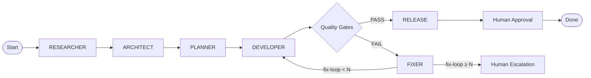

# ADR-016: Integrated SDLC Template Automation

**Status:** Proposed
**Date:** 2026-10-12
**Author:** sdlc-architect (task t_8cf664ab)
**Related:** GAP-ANALYSIS.md (G5), PRD §14, §19, §21, ADR-010 (multi-agent orchestration), ADR-011 (agent runtime), ADR-014 (integration), `docs/adr/ADR-010-multi-agent-orchestration.md`

---

## 1. Context and Problem

PRD §14 defines the **Standard SDLC Workflow** as a mandatory v1 template:

> RESEARCHER → ARCHITECT → PLANNER → DEVELOPER → TESTER+REVIEWER+SECURITY → FIXER → re-verify → RELEASE → HUMAN

With:
- Versioned contracts (JSON Schema)
- Independent checks (TESTER/REVIEWER/SECURITY verify; DEVELOPER report ≠ proof)
- Transition rules (TESTER fail → FIXER; FIXER change invalidates prior candidate checks)
- Auto task creation
- Decision audit
- Fix-loop limit
- RELEASE forms package only (human approves)

**Current state (GAP-ANALYSIS.md G5):**
- Four gates + release-prep + transition enforcement + approval gate **implemented** (`quality-gates/`, 45 tests)
- **Missing as integrated template:** role DAG, fix-loop limit, candidate invalidation on FIXER touch, auto task creation, wiring TEST results to orchestration routing
- ADR-010 specifies the model but it is **not built out**

This is the difference between **having gates** and **having an autonomous SDLC pipeline**.

---

## 2. Requirements (PRD §14, §19, §21 AC-12)

| Req | Description |
|-----|-------------|
| R1 | **Role DAG execution:** Ordered phases with explicit entry/exit criteria |
| R2 | **Fix-loop limit:** Max N iterations (configurable) before escalation |
| R3 | **Candidate invalidation:** Any FIXER source change invalidates prior gate passes |
| R4 | **Auto task creation:** Next phase task auto-created on phase completion |
| R5 | **Decision audit:** Every transition records who/what/why |
| R6 | **Contract versioning:** JSON Schema per phase output |
| R7 | **Independent verification:** TESTER/REVIEWER/SECURITY run independently, not DEVELOPER |

---

## 3. Architectural Decision

### 3.1 SDLC Template as Orchestrator Workflow Definition

The SDLC template is a **WorkflowDefinition** (ADR-011, ADR-013) with a fixed node graph:



### 3.2 Implementation: `SDLCWorkflowEngine` in Orchestration Server

New component: `orchestration_server/sdlc_engine.py`

```python
@dataclass
class SDLCPhase:
    name: str                    # "researcher", "architect", ...
    agent_profile: str           # "sdlc-researcher", "sdlc-architect", ...
    input_contract: dict         # JSON Schema
    output_contract: dict        # JSON Schema
    required_gates: list[str]    # ["tester", "reviewer", "security"]
    max_fix_loops: int           # 3 (configurable)
    auto_create_next: bool       # true

class SDLCWorkflowEngine:
    def __init__(self, orchestrator: OrchestratorEngine):
        self.orchestrator = orchestrator
        self.phases = self._load_standard_phases()

    async def start_sdlc_run(self, project_id: UUID, goal: str, config: SDLCConfig) -> WorkflowRun:
        # 1. Create WorkflowRun with SDLC template definition
        run = await self.orchestrator.create_workflow_run(
            project_id=project_id,
            workflow_definition_id=SDLC_TEMPLATE_ID,
            input={"goal": goal, "config": config.dict()}
        )

        # 2. Create first phase task (RESEARCHER)
        await self._create_phase_task(run, self.phases[0], run.input)

        return run

    async def on_phase_complete(self, run: WorkflowRun, phase: SDLCPhase, output: dict) -> None:
        # 1. Verify output contract
        validate(output, phase.output_contract)

        # 2. Run required gates (if any)
        if phase.required_gates:
            gate_result = await self._run_gates(run, phase, output)
            if not gate_result.passed:
                # Trigger FIXER phase
                await self._enter_fix_loop(run, phase, gate_result)
                return

        # 3. Advance to next phase
        next_phase = self._next_phase(phase)
        if next_phase:
            await self._create_phase_task(run, next_phase, output)
        else:
            # All phases done → RELEASE
            await self._create_release_candidate(run, output)

    async def _enter_fix_loop(self, run: WorkflowRun, failed_phase: SDLCPhase, gate_result: GateResult) -> None:
        run.fix_loop_count += 1
        if run.fix_loop_count > failed_phase.max_fix_loops:
            await self._escalate_to_human(run, gate_result)
            return

        # Invalidate prior candidate gate passes (PRD §14)
        await self.quality_gates.invalidate_candidate(run.candidate_version)

        # Create FIXER task with gate findings as input
        fixer_input = {
            "failed_phase": failed_phase.name,
            "gate_findings": gate_result.findings,
            "prior_output": run.last_phase_output
        }
        await self._create_phase_task(run, self.phases["fixer"], fixer_input)
```

### 3.3 Quality Gates Integration (Candidate Invalidation)

**Quality Gates** must support candidate version invalidation:

```python
# quality_gates/pipeline.py
class QualityGatePipeline:
    async def invalidate_candidate(self, candidate_version: UUID) -> None:
        # Mark all gate runs for this candidate as "invalidated"
        # Next evaluation starts fresh
        await self.evidence_store.invalidate(candidate_version)

    async def evaluate(self, candidate_version: UUID, ...) -> GateResult:
        # Check if candidate was invalidated
        if await self.evidence_store.is_invalidated(candidate_version):
            # Must re-run all gates from scratch
            pass
```

### 3.4 Auto Task Creation & Kanban Integration

- Each phase completion → `kanban_create` for next phase (ADR-013 Kanban API)
- Task linked to `WorkflowRun` (existing `Task.workflow_run_id`)
- Kanban column auto-updates via Orchestration → Kanban sync (ADR-013)

### 3.5 Decision Audit (SagaEvent Extension)

Extend `SagaEvent` types for SDLC:

| Event Type | Payload |
|------------|---------|
| `sdlc.phase.started` | `{run_id, phase, agent_profile, input_ref}` |
| `sdlc.phase.completed` | `{run_id, phase, output_ref, gate_results}` |
| `sdlc.fix_loop.entered` | `{run_id, count, gate_findings}` |
| `sdlc.candidate.invalidated` | `{run_id, candidate_version, reason}` |
| `sdlc.release.created` | `{run_id, release_candidate_id}` |
| `sdlc.human.approved` | `{run_id, approver_id}` |

---

## 4. Consequences

**Positive:**
- SDLC template becomes **executable**, not documentary
- Fix-loop limit prevents infinite FIXER cycles (PRD §14)
- Candidate invalidation ensures gate independence (PRD §2.3)
- Auto task creation = hands-free autonomous runs
- Decision audit via SagaEvent = full traceability

**Negative:**
- `orchestration-server` gains SDLC-specific logic (mitigated: isolated in `sdlc_engine.py`)
- Quality Gates needs `invalidate_candidate` (new API)
- Fix-loop counting requires persistent state on `WorkflowRun`
- Human escalation path needs UI/notification (deferred)

**Deferred (post-v1):**
- Custom SDLC templates (user-defined phase graphs)
- Parallel phase execution (e.g., TESTER+REVIEWER+SECURITY truly parallel)
- Dynamic fix-loop limit per project

---

## 5. Rejected Alternatives

| Option | Rejection Reason |
|--------|------------------|
| External workflow engine (Temporal, etc.) | Over-engineered; Orchestrator already owns workflow execution |
| Hardcoded SDLC in Orchestrator `engine.py` | Violates separation; SDLC is one workflow among many |
| Kanban-only automation (no Orchestrator) | Kanban is a view; Orchestrator owns execution + gates |
| No fix-loop limit | PRD explicitly requires it; infinite loops observed in practice |

---

## 6. Verification

- E2E test: Goal → RESEARCHER → ... → RELEASE → Human → Done (full SDLC run)
- Fix-loop test: Force gate failure → verify FIXER runs → loop N times → escalate
- Invalidation test: FIXER changes source → prior gate passes invalidated → re-run
- Contract test: Each phase output validates against JSON Schema
- Audit test: All SDLC events present in `saga_events` with correct payload

---

## 7. Implementation Sequence

1. **WorkflowDefinition** for SDLC template (ADR-013 models)
2. **SDLCWorkflowEngine** in Orchestration Server
3. **Quality Gates `invalidate_candidate`** API
4. **Fix-loop counting** on `WorkflowRun` model
5. **Auto task creation** via Kanban API (ADR-013)
6. **SagaEvent types** for SDLC audit
7. **E2E SDLC run** test (AC-12)

---

## 8. Open Questions

1. **SDLC config per project:** Store in `Project.settings_json` or separate `SDLCConfig` table?
2. **Parallel gate execution:** TESTER/REVIEWER/SECURITY can run in parallel — Orchestrator should fan-out.
3. **Human escalation UX:** Notification? Kanban card blocked? Separate review task?
4. **Versioned contracts:** Where are phase JSON Schemas stored? `WorkflowVersion` + separate contract registry?

---

*Recorded as part of GAP-ANALYSIS.md response (task t_8cf664ab).*