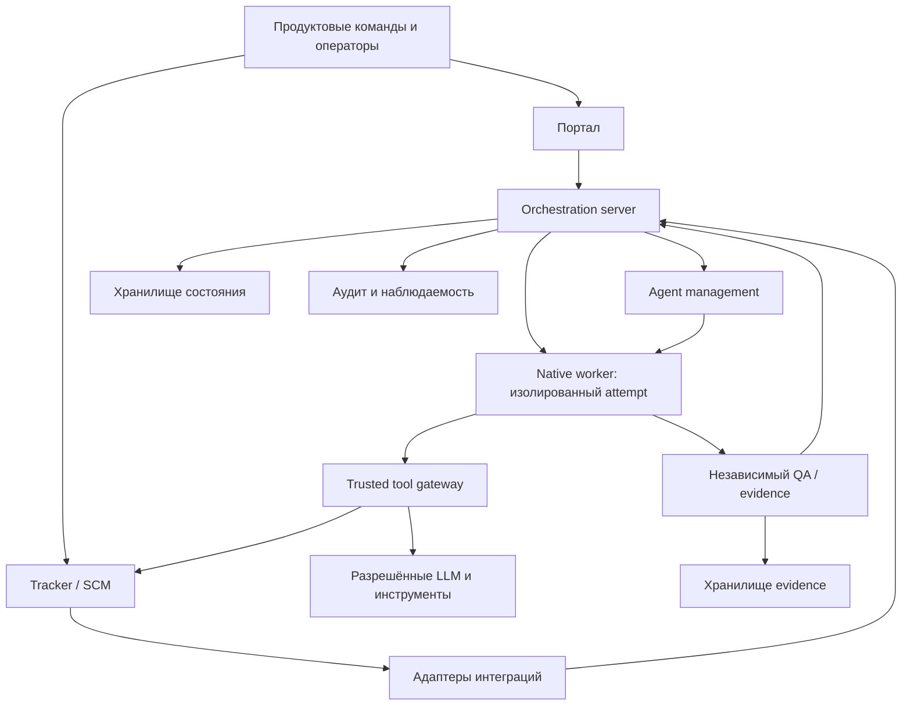

# Enterprise Software Factory: архитектурный аудит и целевая модель

Дата среза: 25.11.2026. Baseline: `6e47938df1f94e783f266c8210de5c92e8c20058`. Статус: проект для review, не production acceptance. Источник: GitHub tree, выборочное чтение исходников/схем, README, OWNERSHIP, актуальные Issues и открытые PR. Тесты не запускались; состояние развёрнутых экземпляров, нагрузка и live provider не проверены. #322, #321, #334.

## 1. Фактическая база и разрывы

Статусы ниже: «код найден» не означает «принято»; «не подтверждено» не означает отсутствия функции.

| Capability | Наблюдение на baseline | Риск / целевое изменение | Issue |
|---|---|---|---|
| Жизненный цикл | orchestration-server: engine.py содержит launch_run, claim_task, submit, recover, reconcile_quarantined_task; models.py содержит TaskAttempt, AttemptLease, SagaEvent | Проверить семантику параллельных DAG, recovery, idempotency и ownership без второго движка | #325 |
| Проекты и доступ | Project, Workspace, Contract и WorkflowRun в models.py; общий auth_middleware.py содержит API-key roles и AuthContext; в изученных моделях не обнаружены отдельные Organization/Team | Tenant isolation и OIDC/service identities не доказаны; проектный фильтр не RBAC | #323 |
| Runtime | Native Agent Loop, trusted gateway, tool ledger; dev и secure Compose overlays в deploy/compose | Dev Compose не production sandbox; нет подтверждённой установки на RKE2, cross-tenant negative tests | #324 |
| Профили и стоимость | AgentDefinition, AgentExecutionBinding, AgentBudgetReservation, TokenUsage в agent-management; native_profile_snapshot.py | Переиспользовать, проверить scope/version, корпоративные квоты, reconciliation, egress | #329 #330 |
| Workflow | WorkflowDefinition/WorkflowVersion, PublishedRunRequest, TaskDependency; schema редактора | #253 открыт; опубликованный граф должен быть источником run, не альтернативный UI шаблон | #325 |
| Проверки и релиз | Quality-gates GateRunGitScope, EvidenceItem, ReleaseCandidate; shared qa_attestation.py, RunReleaseApproval | Проверить независимость, SHA и policy binding; release approval не deploy | #327 |
| Интеграции | tools/github_kanban_sync — dev tooling; отдельные trusted Git worktree/gateway | Продуктовые Jira/Bitbucket/CI connectors и тесты end-to-end не подтверждены | #326 |
| UX | React UI и #253/#256 открыты; #254/#255 закрыты | Portfolio/tenant view и run/approval drill-down проверять по backend состояниям | #328 |
| Observability | Agent journal, runtime metrics и SagaEvent; operations guides | Общий trace и SLO, tenant-scoped audit, redaction и retention не доказаны | #331 |
| Deployment | В дереве найден набор dev/secure Compose; Helm production delivery не подтверждён | RKE2/HA/DR/offline bundle, migration/rollback и отдельная acceptance | #332 |
| Нормативная база | OWNERSHIP, GitFlow, VitePress, ADR, исторический PRD audit | Версионированный PRD и единые контракты/инструкции | #334 |

Прямые точки проверки: [модели оркестрации](https://github.com/askarahodov/multi-agent-workflow/blob/6e47938df1f94e783f266c8210de5c92e8c20058/services/orchestration-server/orchestration_server/models.py), [engine](https://github.com/askarahodov/multi-agent-workflow/blob/6e47938df1f94e783f266c8210de5c92e8c20058/services/orchestration-server/orchestration_server/engine.py), [профили](https://github.com/askarahodov/multi-agent-workflow/blob/6e47938df1f94e783f266c8210de5c92e8c20058/services/agent-management/agent_management/models.py), [общая авторизация](https://github.com/askarahodov/multi-agent-workflow/blob/6e47938df1f94e783f266c8210de5c92e8c20058/packages/shared/auth_middleware.py), [QA](https://github.com/askarahodov/multi-agent-workflow/blob/6e47938df1f94e783f266c8210de5c92e8c20058/services/quality-gates/quality_gates/models.py).

## 2. Актуальные связанные задачи

На момент чтения API: #3 и #11 закрыты, #8/#44/#209/#253/#256 открыты, #254/#255 закрыты. Это статусы Issues, не доказательство runtime acceptance. Документ REPO-STATUS датирован 03.11 и не является текущим источником статусов. Открытые PR #316 (stream) и #317 (run acceptance) не считать частью baseline. Не дублировать их изменения; перед реализацией проверять новый SHA.

## 3. C4: контекст и контейнеры (предложение)

Контекст: IdP выдаёт идентичность; каждый контур имеет отдельные хранилища и разрешённые endpoints. Портал не принимает решение о полномочиях. Внешний tracker не изменяет внутреннее состояние напрямую; события проходят проверку и дедупликацию.

## 4. Владение и доверенные границы

- Orchestration владеет run/task/attempt, DAG, lease, transition, reconciliation и привязкой к immutable candidate. Никакой второй таблицы «истинного» состояния в портале.
- Agent management владеет профилями, моделью, доступом к provider, budget reservation; worker получает минимальную ограниченную capability, не API secrets.
- Runtime запускает worker в ограниченной среде, выдаёт workspace и ограничения; gateway повторно проверяет scope на границе side effect.
- Quality gates владеет независимым verdict и evidence; не принимает self-reported commit как проверенный; подписывающие ключи вне worker.
- Identity/tenant boundary связывает subject, team, project, environment и action. Решения применяются backend-side, включая events/artifacts; UI только отражает.
- Connector отвечает за inbound/outbound idempotency и внешний факт PR/CI, не за внутренний verdict. Корпоративные знания и skills — versioned, scoped, с provenance.

## 5. Модель угроз (начальный реестр)

| Угроза | Контроль | Проверка |
|---|---|---|
| Подмена tenant/project | Scoped identity + authorization на каждой границе | Cross-tenant API/stream/evidence |
| Prompt injection / tool abuse | Недоверенный контекст, deny by default, gateway | Запрещённые операции до side effect |
| Побег из sandbox | Non-root, no host socket, network isolation, выбор runtime после threat model | Негативный тест RKE2 |
| Повтор записи после сбоя | Durable ledger, fencing, quarantine и reconciliation | Pod kill/restart |
| Подделка QA/approval | Независимая identity, signed evidence, candidate SHA | Stale/forged receipts |
| Утечка секретов / egress | Secret broker, redaction, allowlist, локальные endpoints | Denied egress и secret tests |
| Перерасход | Atomic budget reservation, quotas, cancellation | Конкурентные runs |
| Компрометация артефакта | Provenance, digest, подпись, независимый release gate | Подмена digest |

Полная STRIDE-модель и residual risk требуют review #324/#327/#342.

## 6. Архитектурные решения для согласования

1. Сохранить существующий движок как владельца состояния; Temporal/Argo — только после измеренного разрыва и ADR, не обязательная зависимость.
2. Сохранить native provider loop. LiteLLM допустим как optional adapter при доказанной пользе, не как новый владелец budget/lifecycle.
3. MCP использовать как tool integration contract; gateway не отменяет execution boundary. A2A не обязателен для внутренней диспетчеризации.
4. PostgreSQL — целевой transactional store enterprise; проверить текущую совместимость и миграции, не объявлять SQLite production HA.
5. RKE2 — целевая среда, уровень sandbox (gVisor/Kata/VM) выбирается по threat model и стендовым проверкам.

## 7. Миграция

A: #335–#339 + #322 — канонические требования, реестр контрактов, решения и baseline.
B: #323 + #324 — tenant/IAM и runtime; additive migration, backfill, fail-closed и независимые negative tests; rollback до включения feature flags.
C: #325–#327 — graph/blueprints, connectors, policy/QA; совместимость старых runs, no automatic replay.
D: #328–#331 — портал и расширения с существующим API; не менять UX до готовности server semantics.
E: #332/#333/#349 — стенд, restore, HA, offline/live evidence, operator approval.

Для каждого изменения: миграция на копии данных, exact SHA, CI, независимое review, documented rollback. Не включать shared/prod режим при неизвестной границе безопасности.

## 8. Незакрытые проверки

Полный code-level review маршрутов и tenant scopes, schema drift, CI на точном SHA, актуальный ruleset approval, реальный Compose/RKE2, live provider с разрешённым бюджетом, SLO/capacity и независимое согласование ADR. До этих проверок статус #322 — частично выполнено; enterprise readiness UNKNOWN. Владелец продукта должен утвердить целевую модель и NFR.
