# EPIC-INT E2 — Архитектурный аудит подсистем (TASK-01)

> **Эпик:** `t_e447180c` (P1). **Зависимость:** E1 (`t_542608cd`) — отчёт `docs/integration-audit/00-current-state.md`.
> **Репозиторий:** `/mnt/data/multi-agent-workflow`, базовая ветка `main` (HEAD `eba4685`). Рабочая ветка: `epic-int/e2-arch-audit`.
> **Роль:** Solution Architect + System Analyst. Не менять код приложения — только документацию/ADR/контракты.

---

## 1. Актуальная компонентная схема (Mermaid)

```mermaid
flowchart TB
  subgraph Frontend["Frontend (React + Vite + TypeScript)"]
    direction TB
    App["App.tsx<br/>(Editor Shell)"]
    Canvas["WorkflowCanvas.tsx<br/>(React Flow)"]
    Palette["NodePalette.tsx"]
    Panel["PropertyPanel.tsx"]
    Store["store.ts (Zustand)"]
    HttpAdapter["httpAdapter.ts<br/>(ApiAdapter impl)"]
    MockAdapter["mockAdapter.ts<br/>(ApiAdapter impl)"]
    Client["client.ts<br/>(createApiClient)"]
    Types["types.ts<br/>(ApiAdapter contract)"]
    WorkflowTypes["workflow/types.ts<br/>(WorkflowDefinition)"]
  end

  subgraph Orchestration["Orchestration Server (FastAPI + SQLAlchemy)"]
    direction TB
    API["api.py<br/>(FastAPI routes)"]
    Engine["engine.py<br/>(OrchestrationEngine)"]
    Models["models.py<br/>(SQLAlchemy models)"]
    Schemas["schemas.py<br/>(Pydantic DTO)"]
    OpenAPI["docs/openapi.json<br/>(generated)"]
    DB[("PostgreSQL")]
  end

  subgraph AgentMgmt["Agent Management (FastAPI + SQLAlchemy)"]
    direction TB
    API2["api.py<br/>(/api/v1 router)"]
    Services["services.py<br/>(AgentManagementService)"]
    Models2["models.py<br/>(SQLAlchemy models)"]
    ToolPolicy["tool_policy.py<br/>(ToolPolicyEngine)"]
    Providers["providers/*<br/>(ProviderRegistry)"]
    DB2[("PostgreSQL")]
  end

  subgraph Runtime["Runtime Hardening (FastAPI + cgroups v2)"]
    direction TB
    RuntimeAPI["api.py<br/>(RuntimeService)"]
    RuntimeModels["models.py<br/>(Pydantic models)"]
    ContainerRuntime["container_runtime.py"]
    ResourceManager["resource_manager.py"]
    WorkspaceManager["workspace_manager.py"]
    CircuitBreaker["circuit_breaker.py"]
    Health["health.py"]
    Metrics["metrics.py"]
  end

  subgraph QualityGates["Quality Gates (standalone)"]
    Pipeline["pipeline.py"]
    Gates["gates/*"]
    Main["main.py"]
  end

  subgraph Tools["Tools / Agent Orchestration"]
    AgentTools["agent_orchestration/kanban_tools.py"]
    AgentWorkspace["agent_orchestration/agent_workspace.py"]
    DetectHotspots["scripts/detect-hotspots.py"]
  end

  %% Frontend internal
  App --> Canvas
  App --> Palette
  App --> Panel
  Canvas --> Store
  Palette --> Store
  Panel --> Store
  Client --> HttpAdapter
  Client --> MockAdapter
  HttpAdapter -. implements .-> Types
  MockAdapter -. implements .-> Types

  %% Cross-subsystem (BROKEN)
  HttpAdapter -. "/api/v1/workflows/definitions<br/>NO MATCH in backend" .-> API
  HttpAdapter -. "/api/v1/agents/definitions<br/>EXISTS in AgentMgmt (diff format)" .-> API2
  HttpAdapter -. "/api/v1/model-profiles<br/>EXISTS in AgentMgmt (diff format)" .-> API2
  HttpAdapter -. "/api/v1/tool-policies<br/>EXISTS in AgentMgmt (diff format)" .-> API2

  %% Orchestration internal
  API --> Engine
  Engine --> Models
  API --> Schemas
  Models --> DB
  Schemas --> OpenAPI

  %% AgentMgmt internal
  API2 --> Services
  Services --> Models2
  Services --> ToolPolicy
  Services --> Providers
  Models2 --> DB2

  %% Runtime internal
  RuntimeAPI --> RuntimeModels
  RuntimeAPI --> ContainerRuntime
  RuntimeAPI --> ResourceManager
  RuntimeAPI --> WorkspaceManager
  RuntimeAPI --> CircuitBreaker
  RuntimeAPI --> Health
  RuntimeAPI --> Metrics

  %% Data ownership conflicts
  Models -. "Agent (status: idle/busy)" .-> Models2
  Models2 -. "AgentInstance (status: pending/running/...)" .-> Models

  style HttpAdapter fill:#ffcccc,stroke:#cc0000
  style MockAdapter fill:#ffffcc,stroke:#cccc00
  style API fill:#ccffcc,stroke:#006600
  style API2 fill:#ccffff,stroke:#006666
```



---

## 2. Реальные точки интеграции (REST API)

### 2.1 Orchestration Server — **фактические endpoint (корневой namespace, без `/api/v1`)**

| Метод | Путь | Назначение | Источник |
|-------|------|------------|----------|
| GET | `/health` | Liveness | `api.py:102-104` |
| POST | `/projects` | Создание проекта | `api.py:107-115` |
| GET | `/projects` | Список проектов | `api.py:117-119` |
| POST | `/workspaces` | Создание workspace | `api.py:121-131` |
| GET | `/workspaces` | Список workspaces | `api.py:133-137` |
| POST | `/contracts` | Создание контракта (JSON Schema) | `api.py:140-150` |
| GET | `/contracts` | Список контрактов | `api.py:152-154` |
| POST | `/agents/register` | Регистрация агента | `api.py:157-165` |
| GET | `/agents` | Список агентов | `api.py:167-169` |
| POST | `/workflows/runs` | Запуск workflow-run | `api.py:172-188` |
| GET | `/workflows/runs` | Список раннов | `api.py:190-195` |
| GET | `/workflows/runs/{run_id}` | Детали ранна | `api.py:197-204` |
| GET | `/workflows/runs/{run_id}/tasks` | Задачи ранна | `api.py:206-212` |
| GET | `/tasks/{task_id}` | Детали задачи | `api.py:215-222` |
| GET | `/tasks/{task_id}/attempts` | Попытки задачи | `api.py:224-230` |
| POST | `/tasks/{task_id}/claim` | Захват задачи агентом | `api.py:232-240` |
| POST | `/tasks/{task_id}/attempts/{attempt_id}/submit` | Сдача результата + верификация | `api.py:242-256` |
| POST | `/tasks/{task_id}/attempts/{attempt_id}/fail` | Отказ попытки | `api.py:258-272` |
| POST | `/tasks/{task_id}/block` | Блокировка задачи | `api.py:274-287` |
| POST | `/workflows/tick` | Открытие retry-окон | `api.py:290-292` |
| POST | `/admin/recover` | Восстановление после рестарта | `api.py:294-297` |

**OpenAPI spec:** `orchestration-server/docs/openapi.json` — 17 paths, `servers: []`, версия `0.1.0`. Префикс `/api/v1` **отсутствует**.

### 2.2 Agent Management — **фактические endpoint (префикс `/api/v1`)**

| Метод | Путь | Назначение | Источник |
|-------|------|------------|----------|
| GET/POST | `/api/v1/providers` | CRUD провайдеров | `api.py:77-109` |
| GET/POST | `/api/v1/model-profiles` | CRUD профилей моделей | `api.py:112-139` |
| GET/POST | `/api/v1/tool-policies` | CRUD политик инструментов | `api.py:142-166` |
| GET/POST | `/api/v1/agents/definitions` | CRUD определений агентов | `api.py:169-197` |
| GET/POST | `/api/v1/agents/instances` | CRUD экземпляров агентов | `api.py:200-244` |
| GET | `/api/v1/usage/summary` | Сводка токенов | `api.py:247-249` |
| POST | `/api/v1/completions` | LLM completion | `api.py:262-271` |

### 2.3 Frontend HttpAdapter — **вызываемые пути (база `/api/v1`)**

| Метод | Путь (относительно baseUrl) | Метод адаптера | Источник |
|-------|----------------------------|----------------|----------|
| GET | `/workflows/definitions` | `listWorkflows` | `httpAdapter.ts:60-67` |
| GET | `/workflows/definitions/{id}` | `getWorkflow` | `httpAdapter.ts:69-71` |
| POST | `/workflows/definitions` | `createWorkflow` | `httpAdapter.ts:73-75` |
| PUT | `/workflows/definitions/{id}` | `updateWorkflow` | `httpAdapter.ts:77-82` |
| GET | `/workflows/definitions/{id}/versions` | `listVersions` | `httpAdapter.ts:84-94` |
| POST | `/workflows/definitions/{id}/versions` | `saveVersion` | `httpAdapter.ts:96-105` |
| GET | `/agents/definitions` | `listAgentDefinitions` | `httpAdapter.ts:107-114` |
| GET | `/model-profiles` | `listModelProfiles` | `httpAdapter.ts:116-123` |
| GET | `/tool-policies` | `listToolPolicies` | `httpAdapter.ts:125-127` |

---

## 3. DTO / Схемы / Состояния — сопоставление

### 3.1 Workflow Definition (Frontend vs Backend)

| Аспект | Frontend (`types.ts`, `workflow/types.ts`) | Orchestration Server | Agent Management |
|--------|--------------------------------------------|---------------------|------------------|
| **Сущность** | `WorkflowDefinitionDTO` (id, name, definition, is_active, version, timestamps) | **НЕТ** — нет `WorkflowDefinition` модели | **НЕТ** |
| **Версионирование** | `WorkflowVersionDTO` (version_number, definition_snapshot, changelog) | **НЕТ** | **НЕТ** |
| **Запуск** | **НЕТ** в frontend API | `WorkflowRun` + `Task` + `TaskAttempt` (durable ЖЦ) | `AgentInstance` (отдельный ЖЦ) |
| **Контракт** | `CursorPage<T>` с `after/limit` | Прямые массивы / offset-limit | `items/total` с `offset/limit` |

**Вывод:** Frontend ожидает **CRUD над WorkflowDefinition** — этот домен **отсутствует в orchestration-server**. Есть только **runtime** (`WorkflowRun` + `Task`).

### 3.2 Agent / Model Profile / Tool Policy

| Аспект | Frontend (`types.ts`) | Agent Management (`schemas.py`, `models.py`) | Orchestration Server |
|--------|----------------------|---------------------------------------------|---------------------|
| **AgentDefinitionRef** | id, name, description | `AgentDefinition` (system_prompt, default_model_profile_id, default_tool_policy_id, capabilities, config_schema) | `Agent` (name, status, metadata) — **другая сущность** |
| **ModelProfileRef** | id, name, provider_id, model_id, display_name | `ModelProfile` (model_id, parameters, context_window, cost, capabilities) | **НЕТ** |
| **ToolPolicyRef** | id, name, description | `ToolPolicy` (permissions JSON: fs_read, fs_write, git, shell, network) | **НЕТ** |
| **Пагинация** | `CursorPage` (`after`, `limit`, `next_cursor`) | `offset/limit` → `{items, total}` | Прямые массивы |

### 3.3 Состояния (Status Enums)

| Домен | Сущность | Статусы | Владелец |
|-------|----------|---------|----------|
| Orchestration | `Agent` | `inactive`, `idle`, `busy`, `terminated` | Orchestration Server |
| Orchestration | `WorkflowRun` | `pending`, `running`, `completed`, `failed`, `cancelled` | Orchestration Server |
| Orchestration | `Task` | `pending`, `in_progress`, `completed`, `failed`, `blocked` | Orchestration Server |
| Orchestration | `TaskAttempt` | `running`, `completed`, `failed`, `verification_failed`, `interrupted` | Orchestration Server |
| Agent Mgmt | `AgentInstance` | `pending`, `running`, `completed`, `failed`, `terminated` | Agent Management |
| Runtime | `AgentState` | `created`, `running`, `paused`, `degraded`, `failed`, `terminated` | Runtime Hardening |

**Критический конфликт:** Два независимых владельца «состояния агента» — `Agent` (orchestration) и `AgentInstance` (agent-management). Единого источника истины нет.

---

## 4. Подтверждённые риски (из E1 + углублённый анализ)

| # | Риск | Статус | Доказательство | Влияние |
|---|------|--------|----------------|---------|
| R1 | Контракт API frontend рассинхронизирован с orchestration-server | **ПОДТВЕРЖДЁН** | `httpAdapter.ts` paths vs `api.py` routes — 0 пересечений | Frontend в live-режиме неработоспособен |
| R2 | Нет сквозного ЖЦ workflow между frontend ↔ orchestration | **ПОДТВЕРЖДЁН** | `App.tsx` только мок; нет вызовов `/workflows/runs` | Редактор не может запустить workflow |
| R3 | Tool policy enforcement не подключён к runtime | **ПОДТВЕРЖДЁН** | `ToolPolicyEngine` создан в `services.py:241`, но `enforce`/`allow` nunca вызваны в `run_completion` | Deny-by-default не действует |
| R4 | Дублирующие модели состояния агента | **ПОДТВЕРЖДЁН** | `models.py:80-90` (Agent) vs `models.py:153-184` (AgentInstance) | Риск расхождения статусов |
| R5 | Отсутствует единый CI quality gate | **ПОДТВЕРЖДЁН** | Нет `.github/`, только `frontend/Makefile` | Нет автокачества на уровне репо |
| R6 | Нет воспроизводимого локального запуска всей системы | **ПОДТВЕРЖДЁН** | Нет docker-compose/Dockerfile | Разрозненные инструкции |
| R7 | Тестовые артефакты в Git | **ПОДТВЕРЖДЁН** | `.coverage`, `coverage.xml`, `junit.xml`, `.tar.gz` в `git ls-files` | Загрязнение истории |
| R8 | Чужая терминология (Multi-Agent Workflow Platform) в коде/доках | **ПОДТВЕРЖДЁН** | `grep -rl Multi-Agent Workflow Platform` — 6+ файлов | Путаница, признак переноса без вычистки |
| R9 | **НОВЫЙ** — Отсутствует домен WorkflowDefinition в orchestration-server | **ПОДТВЕРЖДЁН** | `grep -rn WorkflowDefinition orchestration-server` — 0 | Frontend CRUD не может работать |
| R10 | **НОВЫЙ** — Формат пагинации несовместим (cursor vs offset) | **ПОДТВЕРЖДЁН** | `types.ts:95-99` vs `agent-management/api.py:116-122` | Ломает списки в UI |
| R11 | **НОВЫЙ** — Runtime Hardening изолирован, не интегрирован в orchestration | **ПОДТВЕРЖДЁН** | Отдельный FastAPI, свои модели, свои endpoint | Дублирование agent lifecycle |
| R12 | **НОВЫЙ** — Quality Gates не подключены к CI | **ПОДТВЕРЖДЁН** | Автономный фреймворк, не запускается | Нет гейтов на PR |

---

## 5. Архитектурные решения (ADR-101..103)

### ADR-101 — Versioned API Contract
- **Проблема:** Frontend и backend имеют полную рассинхронизацию путей и форматов.
- **Решение:** Единый источник истины — **OpenAPI orchestration-server** (`orchestration-server/docs/openapi.json`). Версионирование через префикс `/api/v1`. Frontend `HttpAdapter` **обязан** соответствовать контракту; MockAdapter — только для тестов/автономной разработки.
- **Последствия:** Необходимо либо расширить orchestration-server доменом WorkflowDefinition, либо перенести frontend контракт в agent-management (но тогда нужен единый gateway).

### ADR-102 — Ownership состояний
- **Проблема:** Дублирование Agent / AgentInstance.
- **Решение:** 
  - Orchestration Server — **единственный владелец** состояний задач и workflow runs (`WorkflowRun`, `Task`, `TaskAttempt`, `SagaEvent`).
  - Agent Management — владение **определениями/конфигурацией** агентов (`AgentDefinition`, `AgentInstance`, `ModelProfile`, `ToolPolicy`, `Provider`).
  - Runtime Hardening — **фактическое исполнение** и изоляция, без дублирования доменных состояний.
  - Таблица «состояние → владелец → хранилище → API» задокументирована в `03-ownership.md`.

### ADR-103 — Enforcement Tool Policy на границе исполнения (deny-by-default)
- **Проблема:** `DEFAULT_PERMISSIVE_POLICY` мёртвый код; `ToolPolicyEngine.enforce` не вызывается при выполнении.
- **Решение:** Точка enforcement — в **Runtime Hardening** (container runtime / workspace manager) и/или в **AgentManagementService.run_completion** перед вызовом провайдера. Политика по умолчанию — deny-by-default; `DEFAULT_PERMISSIVE_POLICY` удалить или пометить `@deprecated` с комментарием «только для тестов».

---

## 6. Зависимости между подсистемами

```
Frontend (editor)
    │
    ├── READ: WorkflowDefinition CRUD  ──✗──► Orchestration Server (НЕТ домена)
    ├── READ: AgentDefinition / ModelProfile / ToolPolicy  ──⚠──► Agent Management (diff format)
    └── WRITE: запуск workflow-run  ──✗──► Orchestration Server (нет UI→server звена)

Orchestration Server
    ├── OWNS: Project, Workspace, Contract, WorkflowRun, Task, TaskAttempt, Agent(runtime)
    ├── REFERENCES: AgentDefinition (из Agent Mgmt) — через ID
    └── CALLS: Agent Mgmt `/completions` для LLM — **НЕТ в коде**

Agent Management
    ├── OWNS: Provider, ModelProfile, ToolPolicy, AgentDefinition, AgentInstance
    ├── PROVIDES: `/completions` endpoint для LLM
    └── DECLARES: ToolPolicy (но не enforce)

Runtime Hardening
    ├── OWNS: контейнеры, cgroups, workspaces, snapshots
    ├── ISOLATES: исполнение агента
    └── INTEGRATION: **НЕТ** — не вызывается из orchestration/agent-mgmt
```

---

## 7. Классификация дефектов (подтверждённые / предполагаемые / закрытые)

| Класс | Дефекты |
|-------|---------|
| **Подтверждённые** (evidence-first) | R1–R12 из таблицы выше |
| **Предполагаемые** (требуют проверки при реализации) | - Производительность JSONB запросов при больших WorkflowDefinition<br>- Конфликты оптимистических блокировок на Task/WorkflowRun<br>- pgvector недоступен в managed PG |
| **Закрытые / не в scope** | - Выбор БД (уже PostgreSQL)<br>- UUIDv7 vs v4 (уже v7)<br>- gRPC vs REST (REST зафиксирован) |

---

*Документ подготовлен в рамках TASK-01 EPIC-INT E2. Все выводы основаны на статическом анализе кода ветки `main` (HEAD `eba4685`) и отчёте E1 (`00-current-state.md`).*