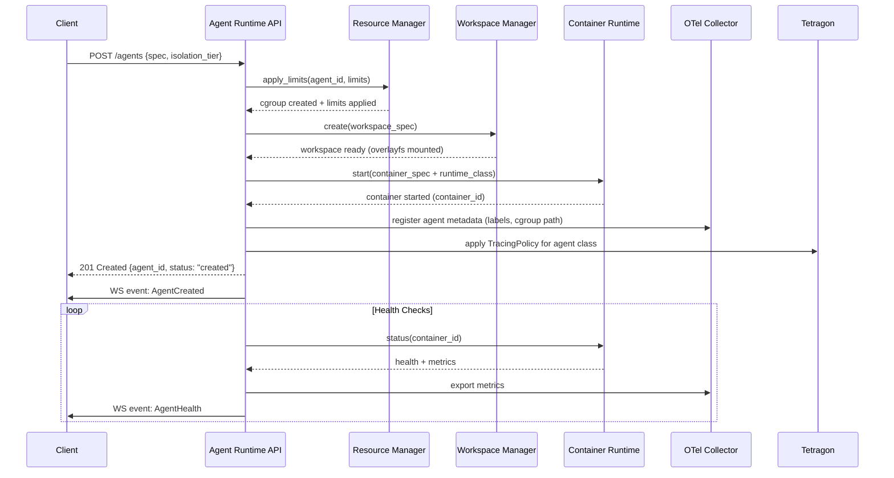
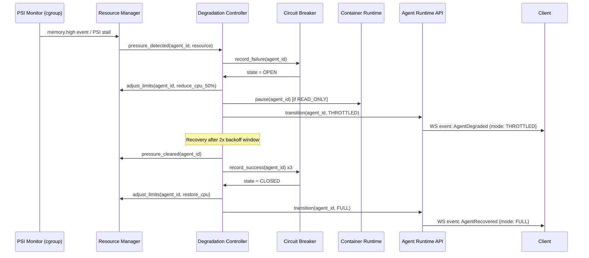

# Component Architecture Diagram

```mermaid
graph TB
    subgraph "Control Plane"
        API[Agent Runtime API<br/>FastAPI + WebSocket]
        RM[Resource Manager<br/>cgroups v2]
        WM[Workspace Manager<br/>overlayfs + tmpfs]
        CB[Circuit Breaker Coordinator<br/>State Machine + Bulkheads]
        DEG[Degradation Controller<br/>Mode Transitions]
    end

    subgraph "Data Plane - Runtime Layer"
        CR[Container Runtime Wrapper<br/>Abstract Base]
        RUNC[runc/crun<br/>RuntimeClass: runc]
        GVISOR[gVisor runsc<br/>RuntimeClass: runsc]
        KATA[Kata Containers<br/>RuntimeClass: kata-fc]
        FIRECRACKER[Firecracker microVM<br/>via Kata]
    end

    subgraph "Data Plane - Agent Sandboxes"
        AGENT1[Agent 1<br/>cgroup: agent-1.scope<br/>user-ns: 100000-100999]
        AGENT2[Agent 2<br/>cgroup: agent-2.scope<br/>user-ns: 101000-101999]
        AGENT3[Agent N<br/>cgroup: agent-N.scope<br/>user-ns: ...]
    end

    subgraph "Workspace Layer"
        BASE[Base Image<br/>Read-only Overlay Lower]
        SCRATCH1[Scratch 1<br/>tmpfs/overlay Upper]
        SCRATCH2[Scratch 2<br/>tmpfs/overlay Upper]
        DURABLE[Durable Volume<br/>Promoted Artifacts]
    end

    subgraph "Observability Stack"
        OTEL_DS[OTel Collector DaemonSet<br/>OTLP, k8sattrs, kubeletstats, filelog]
        OTEL_DEP[OTel Collector Deployment<br/>k8sclusterreceiver, k8sobjects]
        PROM[Prometheus<br/>OTLP Ingest + PromQL]
        TEMPO[Tempo/Jaeger<br/>Traces]
        LOKI[Loki/Elasticsearch<br/>Logs]
        TETRAGON[Cilium Tetragon<br/>eBPF Security]
        ALERT[Alertmanager<br/>PrometheusRule]
    end

    subgraph "Security Boundaries"
        SB1[Host Kernel<br/>cgroup v2 + namespaces]
        SB2[gVisor Sentry<br/>Userspace Kernel]
        SB3[KVM/Hypervisor<br/>Hardware Isolation]
        SB4[User Namespace<br/>UID/GID Mapping]
        SB5[Seccomp Profile<br/>Syscall Allowlist]
        SB6[Network Policy<br/>tc qdisc + Tetragon]
    end

    %% Control Plane Connections
    API --> RM
    API --> WM
    API --> CB
    API --> DEG
    RM --> CB
    DEG --> RM
    CB --> DEG

    %% Runtime Layer
    CR --> RUNC
    CR --> GVISOR
    CR --> KATA
    KATA --> FIRECRACKER

    %% Agent Sandboxes
    RUNC --> AGENT1
    GVISOR --> AGENT2
    KATA --> AGENT3

    %% Workspace
    AGENT1 --> SCRATCH1
    AGENT2 --> SCRATCH2
    AGENT3 --> SCRATCH1
    BASE --> SCRATCH1
    BASE --> SCRATCH2
    SCRATCH1 --> DURABLE
    SCRATCH2 --> DURABLE
    WM --> BASE
    WM --> SCRATCH1
    WM --> SCRATCH2
    WM --> DURABLE

    %% Security Boundaries
    AGENT1 -.-> SB1
    AGENT2 -.-> SB2
    AGENT3 -.-> SB3
    AGENT1 -.-> SB4
    AGENT2 -.-> SB4
    AGENT3 -.-> SB4
    AGENT1 -.-> SB5
    AGENT2 -.-> SB5
    AGENT3 -.-> SB5
    AGENT1 -.-> SB6
    AGENT2 -.-> SB6
    AGENT3 -.-> SB6

    %% Observability
    API --> OTEL_DS
    RM --> OTEL_DS
    WM --> OTEL_DS
    CB --> OTEL_DS
    AGENT1 --> OTEL_DS
    AGENT2 --> OTEL_DS
    AGENT3 --> OTEL_DS
    OTEL_DS --> PROM
    OTEL_DS --> TEMPO
    OTEL_DS --> LOKI
    OTEL_DEP --> PROM
    OTEL_DEP --> TEMPO
    TETRAGON --> PROM
    TETRAGON --> LOKI
    PROM --> ALERT

    %% Styling
    classDef control fill:#e1f5fe,stroke:#01579b,stroke-width:2px
    classDef runtime fill:#f3e5f5,stroke:#4a148c,stroke-width:2px
    classDef agent fill:#fff3e0,stroke:#e65100,stroke-width:2px
    classDef workspace fill:#e8f5e9,stroke:#1b5e20,stroke-width:2px
    classDef obs fill:#fce4ec,stroke:#880e4f,stroke-width:2px
    classDef security fill:#ffebee,stroke:#b71c1c,stroke-width:2px,stroke-dasharray: 5 5

    class API,RM,WM,CB,DEG control
    class CR,RUNC,GVISOR,KATA,FIRECRACKER runtime
    class AGENT1,AGENT2,AGENT3 agent
    class BASE,SCRATCH1,SCRATCH2,DURABLE workspace
    class OTEL_DS,OTEL_DEP,PROM,TEMPO,LOKI,TETRAGON,ALERT obs
    class SB1,SB2,SB3,SB4,SB5,SB6 security
```



## Component Responsibilities

| Component | Responsibility | Key Interfaces |
|---|---|---|
| **Agent Runtime API** | REST/gRPC control plane for agent lifecycle; WebSocket event stream | `POST /agents`, `GET /agents/{id}`, `POST /agents/{id}/pause\|resume\|stop`, `GET /agents/{id}/metrics\|health\|logs`, `WS /events` |
| **Resource Manager** | cgroups v2 unified hierarchy management; three-tier limits; hierarchical quotas | `apply_limits(id, limits)`, `adjust_limits(id, delta)`, `get_usage(id)`, `get_pressure(id)` |
| **Workspace Manager** | Atomic workspace create/snapshot/restore/cleanup; overlayfs + tmpfs; promotion | `create(spec)`, `snapshot(id)`, `restore(id, snap_id)`, `cleanup(id, grace, force)`, `promote(id, paths)` |
| **Circuit Breaker Coordinator** | Per-agent CB state machine; bulkhead pools per resource class | `record_success(id)`, `record_failure(id)`, `get_state(id)`, `acquire_bulkhead(id, resource)`, `release_bulkhead(id, resource)` |
| **Degradation Controller** | Mode transitions (FULL→THROTTLED→READ_ONLY→PAUSED→TERMINATED); recovery coordination | `get_mode(id)`, `transition(id, mode)`, `schedule_recovery(id)` |
| **Container Runtime Wrapper** | Abstract interface over runc/gVisor/Kata; seccomp profile generation; rootless execution | `start(spec)`, `stop(id)`, `pause(id)`, `resume(id)`, `status(id)`, `logs(id)` |
| **OTel Collector (DaemonSet)** | Per-node telemetry collection; K8s metadata enrichment; log/file collection | OTLP/gRPC/HTTP receivers; `k8sattributes`, `kubeletstats`, `filelog` processors |
| **OTel Collector (Deployment)** | Cluster-level receivers; event correlation | `k8sclusterreceiver`, `k8sobjectsreceiver` |
| **Cilium Tetragon** | eBPF runtime security observability + enforcement; process lineage; syscall blocking | `TracingPolicy` CRDs; gRPC/JSON event export |

## Security Boundaries (Defense in Depth)

```
┌─────────────────────────────────────────────────────────────────┐
│                        HOST OS                                   │
│  ┌─────────────────────────────────────────────────────────┐    │
│  │              CONTAINER RUNTIME (runc/gVisor/Kata)        │    │
│  │  ┌───────────────────────────────────────────────────┐   │    │
│  │  │              AGENT PROCESS (user-ns mapped)        │   │    │
│  │  │  ┌─────────────────────────────────────────────┐  │   │    │
│  │  │  │         INNER SANDBOX (bubblewrap/nsjail)   │  │   │    │
│  │  │  │  ┌─────────────────────────────────────┐   │  │   │    │
│  │  │  │  │       AGENT TOOL EXECUTION          │   │  │   │    │
│  │  │  │  └─────────────────────────────────────┘   │  │   │    │
│  │  │  └─────────────────────────────────────────────┘  │   │    │
│  │  └───────────────────────────────────────────────────┘   │    │
│  │  ┌───────────────────────────────────────────────────┐   │    │
│  │  │         WORKSPACE (overlayfs: base + scratch)     │   │    │
│  │  └───────────────────────────────────────────────────┘   │    │
│  └─────────────────────────────────────────────────────────┘    │
│  ▲                    ▲                    ▲                    │
│  │ cgroup v2          │ Seccomp            │ Network            │
│  │ Resource Limits    │ Allowlist          │ tc qdisc           │
│  └────────────────────┴────────────────────┴────────────────────┘
└─────────────────────────────────────────────────────────────────┘
```

## Data Flow: Agent Creation



## Data Flow: Degradation Transition

