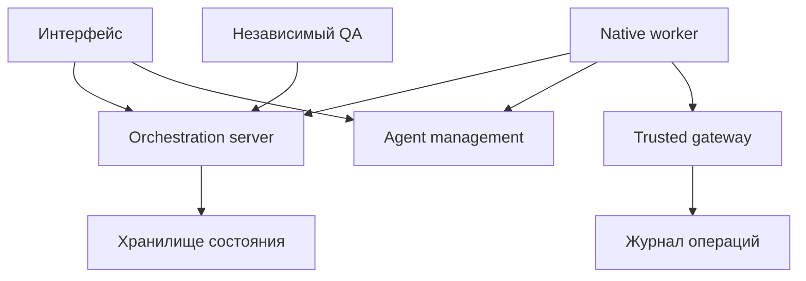

# Обзор архитектуры

Multi-Agent Workflow — платформа управляемой агентной разработки. Ниже описаны существующие компоненты, а не обещанная готовность всех корпоративных возможностей. Источник границ — [карта владения](../architecture/OWNERSHIP.md) и [ADR-111](../adr/ADR-111-native-sdlc-dependencies.md).

## Компоненты

| Компонент | Ответственность |
|---|---|
| orchestration-server | Проекты, workspace, контракты, определения и версии workflow, run/task/attempt, зависимости, lease, переходы, восстановление |
| agent-management | Провайдеры, модельные профили, определения агентов, tool policy, native agent loop, доверенный gateway и журнал вызовов |
| quality-gates | Независимые проверки, evidence, release candidate |
| runtime-hardening | Управление локальной средой и ограничениями исполнения; dev Compose не является production sandbox |
| frontend | Проект, настройки, редактор, запуск, карточка задачи и журнал; не владелец состояния |
| packages/shared / packages/agent-runtime | Общие примитивы авторизации, fencing, QA attestation, runtime loop |

Это логическая схема ответственности; конкретные сети, доверенные credentials и компоненты определяет выбранный deployment profile.

## Жизненный цикл

Пользователь настраивает проект и профили, сохраняет и публикует версию графа. Сервер повторно валидирует snapshot, создаёт run и задачи. Подключённый native worker запрашивает допустимую попытку через HTTP claim. Инструменты исполняются в разрешённых границах; результат и Git evidence относятся к конкретной попытке. Независимая проверка и операторское согласование не заменяются самоотчётом разработчика.

Текущие ограничения исполняемого графа перечислены в [сценарии публикации](published-workflow-run.md). Неисполняемые типы узлов не должны молча игнорироваться. Сохранённая модель или профиль не гарантирует подключения worker, а статус завершения не даёт разрешения на production deploy.

## Безопасность и восстановление

Control Plane владеет переходами, trusted gateway — проверкой разрешённых операций, QA — независимыми доказательствами. Не передавайте worker signing keys или provider credentials. Не повторяйте неоднозначный side effect автоматически; см. [восстановление](../architecture/safe-worker-recovery.md).

Для локальной проверки используется [dev Compose](getting-started.md), для защищённого native runtime — [отдельный runbook](../NATIVE_WORKER_ACCEPTANCE_RU.md). Dev Compose не предназначен для публичного доступа. Корпоративный IAM, межкомандная изоляция, масштабирование в Kubernetes и интеграции относятся к Epic #321 и требуют отдельной приёмки.

## Инструменты разработки и продукт

Hermes/Kanban, GitHub sync и старые dispatcher scripts используются для разработки самой платформы. Они не являются обязательными компонентами продукта и не должны подменять orchestration-server. Не создавать второй источник состояния run/task.
